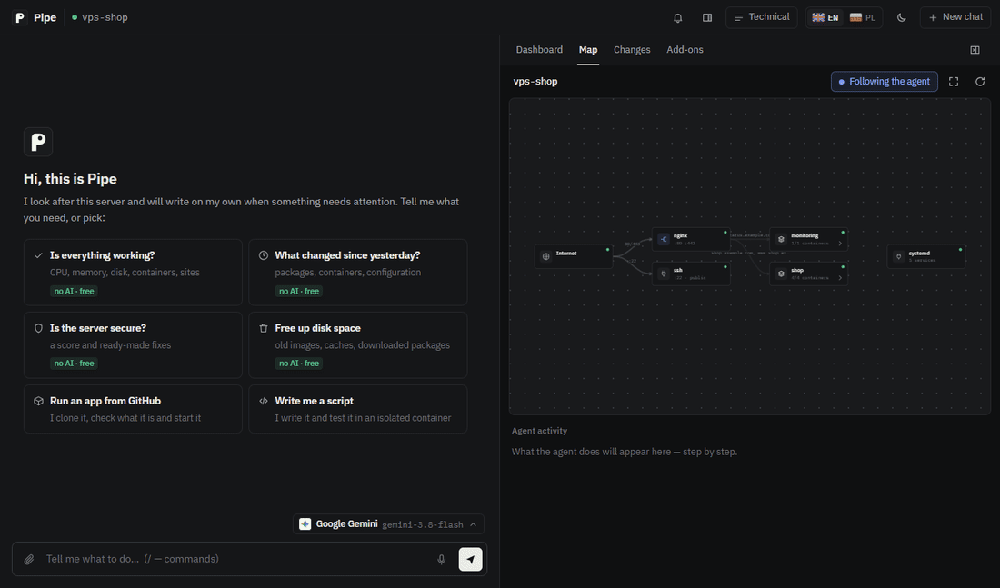

<p align="center">
  
</p>

<h1 align="center">Pipe</h1>

<h3 align="center">A sysadmin that never sleeps, does the routine work itself and asks about what matters.</h3>

<p align="center">
  Pipe is an AI agent that lives on your Linux server. When something breaks, it messages you on Telegram,<br>
  finds the cause and fixes it. It makes routine fixes by itself, with a backup you can undo in one command. It asks about the important ones.
</p>

<p align="center">
  
  <a href="https://github.com/Kvmyk/pipe/actions/workflows/ci.yml"></a>
  <a href="./LICENSE"></a>
</p>

<p align="center">
  <b>🇬🇧 English</b> · <a href="./README.pl.md">🇵🇱 Polski</a> ·
  <a href="https://kvmyk.github.io/Pipe/">Website</a> ·
  <a href="#installation">Installation</a> ·
  <a href="https://kvmyk.github.io/Pipe/docs/">Documentation</a>
</p>

<p align="center">
  
  <br>
  <sub><code>pipe web</code> recorded from a scripted session (<a href="scripts/demo">scripts/demo</a>).</sub>
</p>

## What it is

You install Pipe on a server and leave it there. You talk to it from a terminal, a browser or Telegram, in English
or Polish. Ask it to diagnose something ("why is the shop slow?"), change something ("raise the PHP memory limit")
or explain something ("what changed since yesterday?").

Pipe keeps working between conversations. Every two minutes it checks disks, memory, load, containers and ports
open to the internet. Every hour it records the state of the server, so it knows what changed and when. You don't
have to ask: when something is wrong, Pipe writes first, to Telegram, the browser or the terminal. On a serious
failure it checks the cause right away and sends what it found, with a *Fix it* button. It also warns you before
something becomes a problem: "the disk will be full in about 4 days", "I can free up 6 GB". Every morning a short
report arrives.

The agent reads the server freely. Routine changes, like restarting a service, reloading nginx or fixing a config
file, it makes by itself, with a backup and a check before and after. Before it deletes data, touches access to the
server (SSH, users, firewall) or runs a command it doesn't know, it asks. A classifier written in code (not in the
prompt) decides that, and destructive operations are always refused. The conversation shows every command and a few
lines of its output.

Pipe works with any model that speaks the OpenAI API. The default is Google Gemini, which has a free tier.

## Examples

| You write | Pipe |
|---|---|
| *the site went down overnight, what changed?* | goes through the change history (packages, container images, ports, configs) and points at what changed right before the outage |
| *show me the server architecture* | draws a diagram: domains, reverse proxy, containers, databases, ports exposed to the internet |
| *how secure is this server?* | scores it 0–100 and gives a ready fix for every finding; *"fix 1"* applies it with a backup |
| */vulns* | shows known vulnerabilities in packages, container images, on remote servers and in applications, each with a short explanation |
| */patch* | installs the fixes right away in the server's packages, container images and on remote servers, then removes old images and caches; it does not ask about every command (images only: */patch images*) |
| *every day at 7 check backups and certificates* | sets up a routine and messages you on Telegram only when something is off |
| *check the disks on all servers* | sends parallel helpers (workers) to remote machines over SSH |
| *is our PostgreSQL still supported?* | reads the version on the server and checks it against endoflife.date |
| *undo the last change* | restores the files from the backup taken before the change |
| *set up this app for me: https://github.com/acme/notebook* | clones the repository, works out what it is and how to run it, starts it in a container and gives you the address; asks once, before starting it |
| *write a script that counts the orders in the logs* | writes the script in its working directory, runs it in an isolated container and hands you the result |
| *why is this broken?* + a screenshot or a log | looks at the screenshot, reads the log (secrets hidden from the model) and looks for the cause on the server |

## For Claude Code, Codex and other agents

If you already work with an agent in the terminal, you don't have to give it SSH to production. Connect it to Pipe
over MCP. The agent gets a `run_command` tool that goes through the same classifier as a chat with Pipe. Reads run
right away, forbidden commands are refused, and every change waits for your approval on Telegram (in the CLI:
`/zgody`). After you approve, Pipe backs up the files, checks the config before the reload and after it, and when
something stops working it restores the previous version. Every change goes to the journal and can be undone.

The agent also gets what Pipe knows about the server: the history of changes, the service map, check and audit
results.

Create a separate token for the agent on the server, then add Pipe as an MCP server on your computer:

```bash
python3 -m backend.tokens add claude-code --role admin                 # on the server, in the Pipe directory
claude mcp add pipe -e AGENT_TOKEN=<token> -- pipe --mcp --host root@server   # Claude Code on your laptop
```

`pipe connect <program> --host root@server` prints a ready configuration for other programs: `claude`,
`claude-desktop`, `cursor`, `codex`, `hermes` or `openclaw`. So Hermes Agent and OpenClaw can work on the server
through Pipe, with the same approvals and `/undo`. Pipe doesn't need its own model for this: with `LLM_PROVIDER=none` your agent does the
thinking and Pipe guards what gets executed. Details: [docs/features.md](./docs/features.md) (MCP section).

## What it does

**Watches the server on its own.** The two-minute checks run without a language model, so they cost nothing.
Pipe finds domains in the nginx, Caddy and Traefik configuration by itself and watches certificate expiry, site
responses and DNS. It notices new accounts, SSH keys and suspicious logins. It also accepts alerts from
Alertmanager, Grafana, Uptime Kuma and GitHub and starts looking into the cause right away.

**Sets things up and writes code by itself.** It keeps projects in one directory on the server
(`/root/pipe-workspace`). There it clones repositories, writes scripts and runs them without asking, but always in a
separate container with no access to the rest of the server, so no Node.js or Python piles up on the host. It asks
before putting something up for good, and that deployment can be undone too.

**Saves tokens.** Alerts, suggestions, the morning report, `/status` and `/cleanup` don't use the model at all. When
a conversation does go to the model, Pipe sends only the tools that conversation needs (about 2.1k tokens instead of
6k on every step) and shortens old command output. `/cost` shows how much was not sent this way.

**Changes things carefully.** Before every change it backs up the files. It validates configuration before
reloading (`nginx -t`, `sshd -t`, `docker compose config`) and afterwards checks that the service runs and the sites
still respond. If they don't, it restores the previous version by itself. Everything goes into a journal and can be
undone with `/undo`.

**Remembers the server.** It keeps facts about the server in `SERVER.md`, a map of where repositories, applications
and backups live, and proven procedures as skills. It also remembers resolved incidents: when a problem comes back,
it starts from what helped last time.

**Manages several machines.** Remote servers (SSH), containers and Kubernetes clusters are added as targets. Nothing
is installed on the other side. Workers investigate targets in parallel and only read; changes come back to you as
proposals.

**Searches the web when it doesn't know something.** An unknown error message, a new version, a CVE: Pipe searches
the web (DuckDuckGo, Stack Exchange, Wikipedia) and cites its sources. No API key needed.

**Works with other agents.** Claude Code, Cursor or your own agent can work on the server through Pipe (MCP). Reads
run right away, and every change waits for your approval on Telegram
([above](#for-claude-code-codex-and-other-agents)).

## Installation

On the server (Docker; the wizard asks for the model provider and API key):

```bash
git clone https://github.com/Kvmyk/pipe && cd pipe
sudo bash scripts/install-server.sh
```

The installer pulls a ready image from ghcr.io, signed at release (with `--build` it builds it on the server from
source). Without Docker: `sudo bash scripts/install-server.sh --mode native`.

No API key? Pick Google Gemini and create a free key at
[aistudio.google.com/apikey](https://aistudio.google.com/apikey). On the free plan, though, Google may learn from your
prompts, and those contain the server's logs and configs, so on production enable billing or pick another provider.
You can also choose "No model": Pipe watches the server, sends alerts and reports, works as an MCP gateway and
sends nothing out. You turn chat on later by adding a provider.

On your own computer install the client and type `pipe`. It connects to the server through an SSH tunnel:

```bash
bash install.sh          # Linux and macOS
.\install.ps1            # Windows (PowerShell)
```

`pipe web` opens the browser version, with a map of the server that shows where the agent is working. No extra port
is opened on the server.

Want to open it on your phone without a tunnel? Write `/web on`. Pipe gets an HTTPS address with a certificate, and you
let each new device in once, with a button in a message from Pipe, after checking the code on its screen.

Don't want to install anything on the server by hand? Install only the client, skip the address and type `pipe web`.
The page asks what you want to do and sets Pipe up itself: on this computer (Docker) or on your server over SSH. The
password stays on your computer. There are two views: simple (chat, reminders, skills, add-ons for apps) and technical
(plus the server map, changes, vulnerabilities). Change it any time with `/view`, also in the terminal and on Telegram.

Telegram (recommended, alerts arrive there): fill in `clients/telegram/.env` (bot token and your user id) and run the
installer again. Pipe speaks English by default. For Polish add `--lang pl` to the installer, or type
`/language pl` at runtime (the CLI and `pipe web` follow the server).

Other ways to deploy (native with systemd, Kubernetes, cloud-init) are described in
[docs/deploy.md](./docs/deploy.md).

Want to see how it works first, without your own server? `python3 sandbox/run.py try --scenario nginx-502` starts a
container on your computer that pretends to be a server with a broken nginx, with Pipe inside. The same scenarios are
used to check which models can handle the fixes: [sandbox/README.md](./sandbox/README.md).

## Security

- Without asking Pipe runs recognised reads and routine changes it can check and undo. It asks about deleting data,
  access, autostart, sending data outside the server and unknown commands. `AUTONOMY=0` means a question for every change.
- The confirmation shows exactly the command that will run, together with the backup and verification plan.
- API keys, passwords and tokens from files are hidden before any text reaches the model provider.
- Workers and routines only read. Every operation is written to an audit log.

An important limitation: in Docker mode Pipe has access to `docker.sock`, which in practice means root on the server.
The protection is that without asking Pipe does only routine work with a backup, and everything else waits for your
confirmation. Full description: [docs/security.md](./docs/security.md).

If you'd rather start carefully, install Pipe with `--profile observe`. It then gets no `docker.sock` (it sees Docker
read-only), `/root` is read-only, and every change is refused without asking. Pipe still watches the server, answers
questions and sends alerts. Turn on full mode later with `--profile full`.

Found a vulnerability? Report it privately, not in a public issue: [SECURITY.md](./SECURITY.md).
Want to help another way? See [CONTRIBUTING.md](./CONTRIBUTING.md).

## Documentation

The documentation is also on the website: [kvmyk.github.io/Pipe/docs](https://kvmyk.github.io/Pipe/docs/).

| | |
|---|---|
| [Quick start](./docs/quickstart.md) | installation step by step |
| [Features](./docs/features.md) | watching, workers, routines, diagrams, `pipe web`, MCP |
| [Deployment](./docs/deploy.md) | Docker, systemd, Kubernetes, clouds |
| [Backend](./docs/backend.md) | configuration, `.env` variables, agent tools |
| [CLI](./docs/cli.md) and [Telegram](./docs/telegram.md) | clients and commands |
| [Security](./docs/security.md) | classifier, confirmations, limitations |
| [Protocol](./docs/protocol.md) | how clients talk to the backend |
| [Changelog](./docs/changelog.md) | what changed in each version (entries before v0.49 in Polish) |

## License

MIT, see [LICENSE](./LICENSE). Bug reports and pull requests are welcome.

<sub>LLM provider logos in `pipe web` are trademarks of their owners and only indicate whose models the agent connects
to; Pipe is not affiliated with these companies (`clients/webui/static/providers/NOTICE.md`). IBM Plex Sans and IBM
Plex Mono typefaces: SIL Open Font License 1.1 (`clients/webui/static/fonts/OFL.txt`).</sub>
